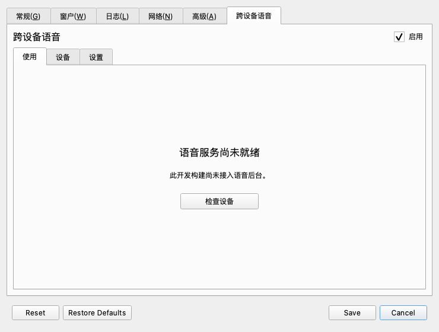

# 原生设置与只读设备检测

日期：2026-10-27。基于 `feature/voice-foundation`，开发分支 `feature/native-voice-settings`。这一批将精简界面结构接入真实 Qt 设置对话框，完成偏好保存和系统输入设备枚举；语音后台仍待接入。

## 已实现

- 设置新增“跨设备语音”，内部分“使用 / 设备 / 设置”。首页只显示启用、当前状态和主要操作。
- 使用现有配置系统保存启用意图、用途、输入设备 UID、目标电脑和按住说话键。保存生效，取消不写入，重置与恢复默认值接入原有按钮。
- 仅修改语音偏好不重启键鼠核心；修改旧有通用设置仍走原来的应用配置与重启流程。修改判断以加载后的控件值为基准，避免默认语言、网络接口的显示归一化误判成用户修改。
- Mac 通过 CoreAudio、Windows 通过系统音频端点接口只读枚举可用输入设备，保留稳定 UID 和系统默认标记。不新增音频运行库，不录音或更改默认设备。
- 已选麦克风暂时缺失时保留原 UID 并显示不可用，不暗中换成其他来源。当前在打开页面或手动“重新检测设备”时枚举，尚无热插拔订阅。
- 从现有核心对象的结构化 IPC 缓存读取键鼠连接和电脑名称，每秒更新显示；忽略已替换的 IPC 对象，断线时隐藏旧电脑。没有通过日志猜测连接，也没有新增旁路连接。此项为代码接线和编译验证，尚未对运行中的核心做产品实机验收。
- 键鼠已连接、麦克风存在均不算语音就绪；页面明确显示“语音服务尚未就绪”。Mac 接收不可选，首版保持 Mac → Windows、Windows → Windows。

新增文案目前以中文为开发源文本，六种既有翻译目录已生成对应条目，完整多语言翻译尚未完成。

## 验证

本机 macOS ARM64，Qt 6.11.3、OpenSSL 3.6.4、部署目标 macOS 15。完整 GUI/core/检查工具构建通过；`tools/build_macos.py --test` 的六组有限 CTest 全部通过。

`VoiceSettingsTests` 共八个测试方法，加初始化和收尾为 10 passed：显式临时文件往返、缺失设备不换源、控制连接不冒充语音就绪、只读限制、重置基线、语音单独保存不重启、取消不写入、通用设置变更仍要求重启。Windows 上三个完整对话框用例明确跳过，因为现有全局配置入口不支持同样的临时目录隔离；纯模型和页面用例仍运行。

真实 CoreAudio 只读探测返回两项输入设备、无枚举错误。记录不含设备名称、UID 或序列号；没有打开音频流、测试电平或请求录音权限。该结果不能证明任一设备能收音，尤其不能当作 Siri 遥控器增强来源已验收。



上图由编译后的 Qt 对话框离屏渲染；不是网页稿，也不是运行中的 Cocoa 截屏或最终视觉验收。临时启用复选框以展示真实的后台未就绪状态，没有保存到用户配置。

可复现入口，均在构建目录 `bin/` 的独立 `VoiceSettingsPreview` 执行：

```sh
QT_QPA_PLATFORM=offscreen ./VoiceSettingsPreview --probe-devices
QT_QPA_PLATFORM=offscreen ./VoiceSettingsPreview --render /tmp/voice-page.png
QT_QPA_PLATFORM=offscreen ./VoiceSettingsPreview --render-dialog /tmp/voice-dialog.png
```

默认无参数仅显示帮助。完整对话框渲染使用临时配置目录，在 Windows 上禁用该入口，可用独立页面 `--render`。预览工具不安装、不创建 MainWindow/CoreProcess、不启动键鼠捕获或语音服务。开发检查不运行上游真实发键套件。

机器可读记录见 [validation.json](validation.json)。Mac 本地结果不替代 Windows 编译；后者以本分支当前提交的 CI 为准，也不替代 Windows 实机验收。

## 下一步

接入统一语音服务状态和请求接口，完成会话确认、连接代次与异常收尾；先接通 Mac 普通麦克风 → Windows 输入法，再接 Windows 发送端和第二台 Windows。产品界面的启用、试说与故障引导需跟随真实服务状态，之后再完善安装、登录准备、产品身份、签名与干净机器验收。现有可用的私人原型部署没有被这一批替换或重启。
