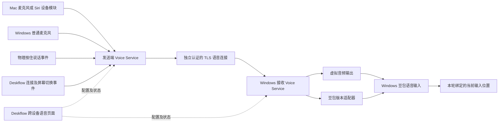

# Deskflow 跨设备语音完整产品方案

方案版本：1.0 · 2026-10-27。用户已确定方向范围；架构、界面与交付建议在本文件中明确为计划。入口：[文档总览](README.md)。

## 1. 产品目标与边界

在 Deskflow 中增加“跨设备语音”能力：用户使用连接到一台电脑的麦克风与按住说话键，将声音送到当前控制的 Windows 电脑，由接收端输入法将文字自然输入当前文本框。配置按设备与输入来源保存，换聊天软件、网页或编辑器无需逐应用设置。

主要用户是已有两台电脑、需要共用键鼠和语音输入的人。首版以局域网内一对设备为单位，不要求用户理解 PID、脚本、证书文件或命令行。发布体验为两端安装同一产品的对应平台包，完成一次向导后日常直接使用。

| 范围 | V1 要求 | 不在 V1 的承诺 |
|---|---|---|
| 方向 | Mac → Windows、Windows → Windows | Windows → Mac、Mac → Mac |
| 网络 | 同一局域网内已连接的 Deskflow 设备 | 云中继、公网穿透、跨账号云同步 |
| 输入来源 | Mac、Windows 普通系统麦克风；Mac Siri 遥控器增强模块 | Windows Siri 遥控器直接收音、所有蓝牙遥控器 |
| 接收端 | 经过兼容验证的 Windows 豆包输入法 | 所有输入法、所有版本、所有权限级别的控件 |
| 使用方式 | 按住说话、松开停止；当前输入位置自动跟随 | 常开麦克风、会议录音、多接收端同时转写 |
| 应用范围 | 普通交互桌面输入框，不要求应用白名单 | 登录屏幕、UAC 安全桌面、密码字段；提权窗口需另验 |

Mac Siri 遥控器能力沿用现有已验证路径，并计划纳入首版增强模块。若其许可或采集依赖未达到发行条件，可以先发明确标注的基础版/预览版；不能把普通麦克风通过描述为遥控器完整安装体验通过。公开 V1 的具体设备支持必须逐项标注。

## 2. 当前成果与缺口

截至本方案的证据日期，Mac → Windows 在两个 Windows 进程间完成四轮真实会话，用户确认两处均能出字、松开停止。两端登录启动管理及恢复已配置并检查，但没有实际执行整机重启。Windows → Windows 的发送端、普通麦克风来源的通用产品实现、统一 UI 和公开安装器仍需开发。

现有成果包括 Mac 右 Option/输入源线程补丁、遥控器发送器、Windows 接收与豆包控制、前台动态绑定、重复会话收尾、有限音频队列、自启管理和验收记录。Windows 的主要源码仍在 Windows 工作区，不能仅上传当前 Mac 目录就宣称源码完整。

当前 Mac 测试应用组合过不同版本的 Qt GUI/core 运行库。正式产品必须从一个明确的工具链、依赖锁定和完整源码构建，现有混合应用包只作为对照依据。证据与开发任务对应表见[依据与决策记录](依据与决策记录.md)。

## 3. 用户首次使用

1. 在两台电脑安装对应平台包，先完成 Deskflow 键鼠连接。
2. 打开“跨设备语音”，启用功能，选择本机作为发送端或 Windows 接收端。Windows 可以具备两种能力，但一次会话只能占用一个方向，不形成回传环路。
3. 发送端选择麦克风和按住说话键；Mac Siri 遥控器走单独的设备配对与组件检查分支。
4. 接收端检查豆包和虚拟音频设备，按向导完成必要安装与系统授权。
5. 对两台设备进行一次语音身份确认，保存设备关系，测试本地收音、音频到达和真实输入。
6. 用户选择登录后自动启动。以后进入桌面后自动等待网络、设备与输入法就绪。

普通麦克风通常只需选择系统已存在的音频设备。蓝牙设备由系统完成配对，软件提供入口与结果检查；不把“声源选择”“蓝牙配对”“两机身份确认”合成同一个含糊步骤。

## 4. 语音页面与状态

页面放在 Deskflow 设置中，名称为“跨设备语音”。首页显示可理解的使用状态，详细组件信息在诊断区按需展开。

| 区域 | 用户可见内容 | 操作 |
|---|---|---|
| 总开关 | 已关闭、待设置、可使用、依赖异常 | 启用、停用 |
| 本机能力 | 发送声音、接收语音；Mac 接收暂不可选 | 选择角色 |
| 目标设备 | 已连接设备、当前控制位置、语音是否可信 | 选择、确认、解除配对 |
| 声音来源 | 麦克风名、输入电平、遥控器连接状态 | 切换来源、重新检测 |
| 按住说话 | 当前快捷键、冲突或设备键状态 | 录制快捷键、恢复默认 |
| 接收设置 | 豆包兼容状态、实际录音设备、组件就绪情况 | 检测、安装指引、修复 |
| 测试 | 收到声音、语音条启动、是否实际出字分别显示 | 分步测试 |
| 自动启动 | 本机登录启动状态与最近恢复结果 | 启用、停用 |
| 诊断 | 可读故障、时间、组件版本 | 复制脱敏诊断、打开帮助 |

故障文案直接说明恢复方法，例如“这台 Windows 尚未安装接收音频组件”“当前豆包版本未通过兼容验证”。用户不需要填写本机路径、PID 或对端 IP；自动发现失败时可提供高级手动地址入口。

## 5. 日常会话规则

仅在已启用、设备已可信配对、目标在受支持的 Windows、音频与输入法都就绪后接受一次新的物理按下。按下时固定本轮接收端与前台窗口身份；随后切换窗口或电脑会结束本轮，不把同一段语音迁移到新位置。松开后收尾，新的按下再绑定新的输入位置。

发送端的物理按键/遥控器事件进入统一的会话控制。产品内部直接调用接收端的输入法适配接口；当前“注入右 Alt → 兼容控制器”的实验串联计划迁移为正式服务调用，避免同一次物理按下被 Deskflow 转发键和语音命令重复处理。普通键鼠行为继续通过回归检查。

断线、设备拔出、来源改变、锁屏、对端退出均停止本轮。连接恢复后等待下一次新按下，不重放旧按键或未完成音频。输入法调用状态不明时停止语音能力并给出修复入口，不反复启动录音，不清理用户已有的其他语音会话。

## 6. 建议架构

统一 Deskflow 界面管理配置与状态；独立用户态 Voice Service 承担音频与会话；平台后端处理声源、快捷键和输入法。独立进程有利于故障隔离，具体第三方组件边界仍须经许可审查，不能仅凭拆进程认定合规。

首版让语音数据使用独立连接，避免把大块音频直接塞进键鼠消息流。利用 Deskflow 设备列表与路由事件选择目标；语音连接仍要独立建立与验证身份。设备显示名或 IP 不代表身份，已有 Deskflow TLS 连接也不自动证明另一个语音端口可信。

通过本机有权限控制的 IPC 获取 Deskflow 屏幕切换、连接和按键事件，替换当前依赖日志文字及高级命令的耦合。音频格式和协议版本通过能力协商确定。已有 PCM、缓冲与会话协议作为迁移基线；协议变更须提供明确的兼容版本，不宣称旧原型和新包天然互通。

## 7. 安装与依赖原则

用户安装产品包时获得所需的产品后台和运行库，无需安装 Python、.NET SDK、编译器或 Codex。初期保留 C# 接收逻辑时采用自包含发布；是否转为统一 C++ 实现以可复现构建和维护成本为依据，不为统一语言重做已验证的行为。

基础安装与可选设备组件分开检查。普通 Windows 麦克风发送不要求在发送端安装虚拟音频驱动；虚拟音频组件属于 Windows 接收端。Mac Siri 模块需要的 PacketLogger、HAL 插件、采集后台及权限逐项说明，不能借普通麦克风的成功省略其安装验证。

产品自有组件可随包交付；第三方组件按许可决定随包、官方引导安装或暂不发行。管理员授权只在确有需要的驱动/系统组件安装步骤请求；日常语音服务在用户交互会话运行。详见[安装流程与依赖处理](安装流程与依赖处理.md)。

## 8. 隐私与运行边界

语音层默认只在按住期间处理声音，不保存音频或识别正文；关闭遥控器声源时不自动换为另一麦克风。Siri 收音底层捕获栈是否留下 HCI 诊断数据，需要作为增强模块发布检查独立验证。

两机语音传输走局域网加密连接。豆包识别是否联网、上传与保留什么由其产品与用户设置决定，因此不能把本产品宣传为“全程离线识别”。诊断默认仅包含版本、会话结束原因、延迟与数量统计，设备名和地址在导出前脱敏。

每台安装独立生成身份与凭据，解除配对可撤销授权；证书失效或身份变化需处理续期/重新确认。个人机器的令牌、证书私钥、固定 IP 与用户名不进入源码或安装包。

## 9. 首版发布条件

两条方向均在没有开发环境、没有旧桥接配置的机器上，按向导完成安装与真实语音输入。每个方向至少完成连续 20 轮按下/松开、两个普通应用之间切换，以及端点重启、网络恢复、睡眠唤醒、输入设备重连、升级与卸载检查。具体场景与门槛见[开发计划](分阶段开发计划.md)。

发布按实际通过的系统、CPU、声源、豆包版本标记兼容性。首批以当前 Mac ARM64 和 Windows x64 组合为候选验证线；Windows x64 需补正式环境采集确认，Intel Mac/Windows ARM64 未通过前不列为正式支持。

第一批面向 3–5 组新用户，记录是否能独立走完向导、失败步骤和恢复方式。两方向都通过才将完整 V1 标为可用；市场需求与长期稳定性以实际内测反馈判断。
