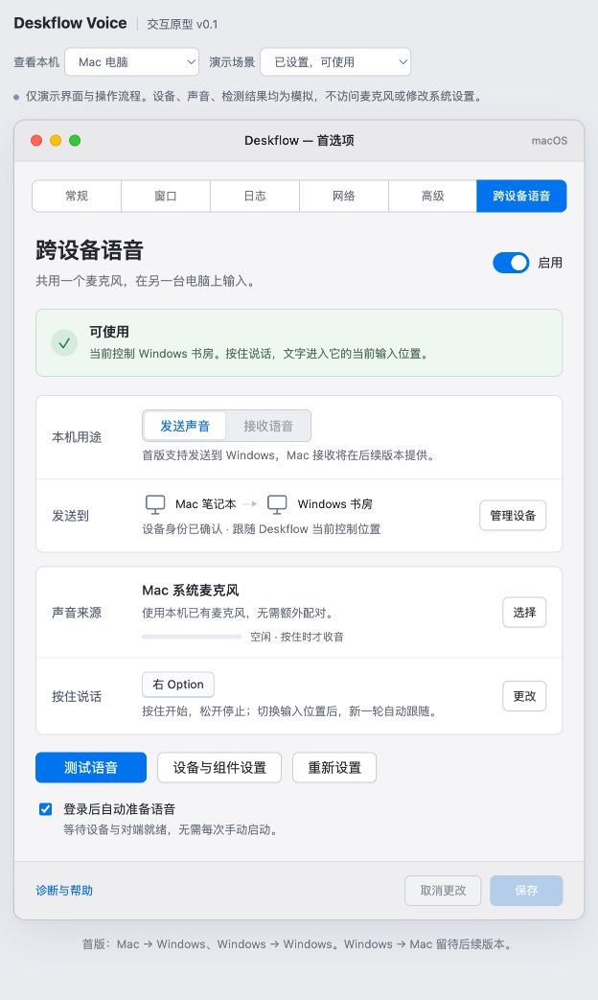
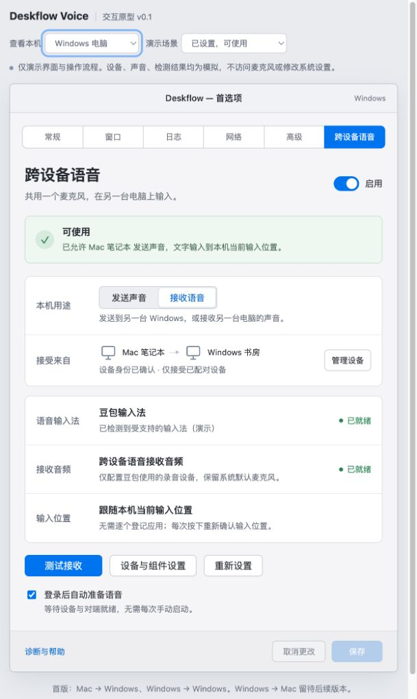

# 界面设计说明 v0.1

## 设计目标

在 Deskflow 首选项增加“跨设备语音”页，沿用桌面设置的密度、分组、按钮和保存操作。日常页面回答四个问题：功能有没有开、声音到哪台电脑、用哪个声源、按哪个键。首次安装与排障进入独立流程，避免主页面堆满组件细节。

可点击入口：[index.html](index.html)。可直接离线打开；网页预览不代表原生 Qt 界面已完成。顶部设备视角和场景选择属于评审工具，正式产品不显示。

## 页面与方向

| 视角 | 本机用途 | 主要内容 |
|---|---|---|
| Mac | 发送声音 | Windows 目标、普通麦克风或 Siri、按住说话键、测试、登录启动 |
| Windows | 接收语音 | 已确认的发送设备、豆包兼容状态、接收音频、当前输入位置 |
| Windows | 发送声音 | 另一台 Windows、本机系统麦克风、可配置说话键 |
| Mac | 接收语音 | 首版不可选，说明后续提供 |

普通麦克风为首次安装的默认来源。Siri 在 Mac 声源列表中选用，单独检查系统配对、专用收音组件和 PacketLogger。切换来源后重新检查，不把普通麦克风的成功沿用到 Siri。

Windows 发送端的 F8 是原型示例默认值，后续仍须真实冲突检测；Mac 原型显示右 Option。接收端不要求用户填写右 Alt 映射。

## 首次设置

1. **选择用途**：解释声音和文字的方向，与 Deskflow 控制端角色分开。
2. **连接设备**：从 Deskflow 已发现的设备中确认对端；两端核对身份后继续。原型码是公开演示值。
3. **准备声音**：按平台和角色检查权限、声源与接收依赖；来源改变会撤销原先的来源检查。
4. **按键与启动**：设置按住说话方式与本机登录启动；接收端只配置启动，不重复配置发送键。
5. **测试完成**：声音、到达、语音启动、真实文字和松开停止分层确认；完整产品必须以用户真实结果为准。

未确认身份、未准备好来源或未完成测试时，相关继续按钮不可用。取消向导恢复进入前的设置；完成才保存本轮设置。普通主页面也保留保存/取消更改。

## 状态与恢复

| 状态 | 页面表现 | 可执行操作 |
|---|---|---|
| 已关闭 | 灰色状态，测试不可用 | 开启、编辑设置 |
| 首次安装 | 明确设置入口 | 启动向导 |
| 已就绪 | 目标和来源清楚，空闲时不显示正在收音 | 测试、修改来源和按键 |
| 对端离线 | 等待上线，禁止测试 | 检查连接；恢复后需新的按下 |
| 新来源未检查 / 来源不可用 | 检查来源，禁止测试 | 来源检查、重新连接或更换来源 |
| 接收音频缺失 | 直接说明 Windows 组件缺失 | 官方安装指引、返回检测 |
| 输入法不兼容 | 明确保留阻断状态 | 查看兼容说明；没有一键假定兼容 |

弹窗处理保持上下文。诊断不显示私人路径、进程 ID、录音或识别内容。原型测试框内显示的预设文字仅用于演示，不属于诊断采集。

## 接入原生产品时的映射

- 启用、配对、来源检查、对端就绪来自真实服务与权限结果；不能沿用原型布尔值作为判定。
- 接收端在每次新按下时绑定当前输入位置，无应用登记。持有期切换、锁屏、断线等由服务负责结束，界面反映真实结果。
- 登录启动按钮后续绑定平台生命周期组件；不把此原型的勾选当作已注册启动。
- 快捷键从候选选择替换为原生录键器和冲突检查。
- 依赖安装和权限入口按实际授权、版本和平台处理。兼容信息必须有真实来源。
- 正式 Qt 页需要重新评估现有首选项窗口的尺寸约束，使用可调整布局和必要的内容滚动；浏览器原型不保证跨平台像素一致。

## 本轮检查

通过浏览器真实点击与可访问性状态核对三种主视图、首次设置、配对门槛、新声源检查、取消更改、兼容阻断、组件指引、离线状态与连续两轮演示。结果见 [ui-validation.json](ui-validation.json)。原型没有录音、网络或系统写入入口；检查不代表实际语音验收。

